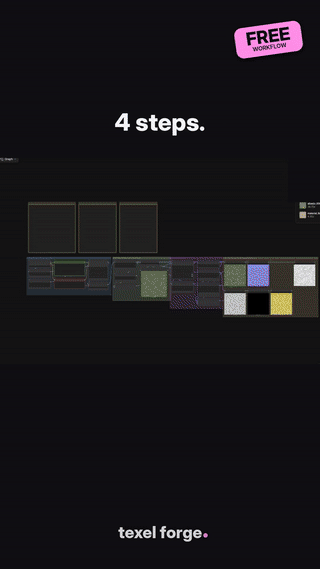
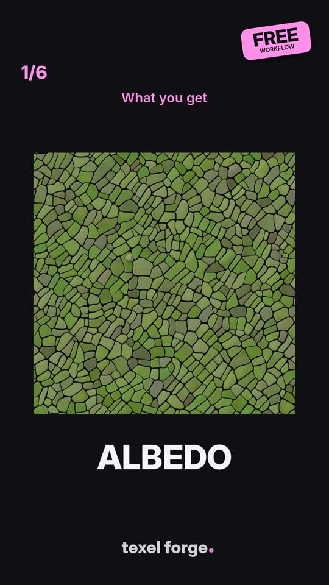

# PBR Studio Free: Text to PBR Material (ComfyUI, SDXL)

Type a material, get a complete **seamless PBR set** in one ComfyUI run:
BaseColor, Normal (OpenGL or DirectX), 16-bit Height, AO, Roughness, Metallic and a packed ORM map.
Runs on an 8 GB GPU (~30 s per material on an RTX 5060 Laptop).

 

**Get it:** [Download free on Gumroad](https://texelforge.gumroad.com/l/pbr-studio-free) (enter $0, get update emails) · or clone this repo · or install the nodes from ComfyUI Manager ("PBR Studio Nodes").

**Pro version:** [PBR Studio Complete](https://texelforge.gumroad.com/l/pbr-studio) adds Photo to PBR, Batch (a whole library from a list) and a tile-safe 4K upgrade.

## How it works
1. **Tileable image.** SDXL tiles through circular padding in the model and the VAE.
2. **De-light.** Removes large-scale light and compresses shadows and highlights → BaseColor.
3. **Depth.** Depth Anything V2 estimates the surface shape, wrap-padded so the edges tile.
4. **Height.** Depth (big shapes) + albedo detail (fine detail), saved as 16-bit PNG. A `surface` setting (rough / flat / polished / auto) controls relief.
5. **Maps.** Normal (OpenGL or DirectX), AO, Roughness, Metallic from height and albedo. ORM = R AO, G Roughness, B Metallic.
6. **Saving.** Each material in its own folder with engine-ready names. Re-runs get `_2`, `_3`, nothing is overwritten.

## Install
**Easiest:** in ComfyUI Manager search **PBR Studio Nodes** and install, or run `comfy node install comfyui-pbr-studio` ([registry page](https://registry.comfy.org/nodes/comfyui-pbr-studio)). Then install the two free nodes and SDXL below (steps 2-4), and open the workflow.

**Installer script:** `python install_pbr_studio.py --comfy "C:\path\to\ComfyUI"`

**Manual:**
1. Copy `custom_nodes/PBR_Studio_Nodes` into `ComfyUI/custom_nodes/`.
2. `git clone https://github.com/kijai/ComfyUI-DepthAnythingV2` into `custom_nodes`, then `pip install -r requirements.txt` with ComfyUI's Python.
3. `git clone https://github.com/spinagon/ComfyUI-seamless-tiling` into `custom_nodes`.
4. Models: [SDXL base 1.0](https://huggingface.co/stabilityai/stable-diffusion-xl-base-1.0/resolve/main/sd_xl_base_1.0.safetensors) → `models/checkpoints/` (Depth Anything V2 Small auto-downloads).
5. Restart ComfyUI, press R, open `workflows/01_PBR_Text_SDXL_Standard.json`.

Full guide: [START_HERE.md](START_HERE.md) · Test prompts: [examples/TEST_PROMPTS.md](examples/TEST_PROMPTS.md)

## Honest limits
- Height, AO and roughness are **estimates from an image**, not scanned data.
- SDXL base does not do every material well (leather, terracotta roof tiles looked fake in tests).
- Metallic defaults to 0 (right for stone, wood, plaster, concrete).

## More
Photo to PBR, Batch (a list of materials in one go) and a tile-safe 4K upgrade are in the full **PBR Studio** bundle: https://texelforge.gumroad.com

## License
Free for personal and commercial projects; the textures you make are yours. Please don't resell or redistribute the workflow or node pack (link to this repo instead). Third-party models and nodes are not included and have their own licenses (SDXL: CreativeML Open RAIL++-M, Depth Anything V2 Small: Apache 2.0, ComfyUI-seamless-tiling: GPL-3.0).

Made by **Texel Forge**.
